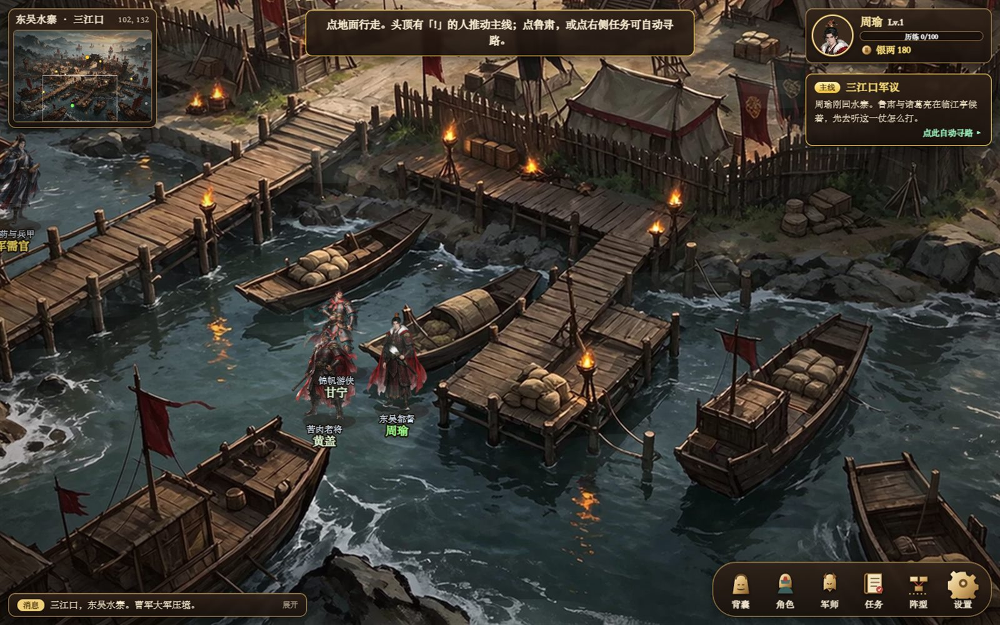
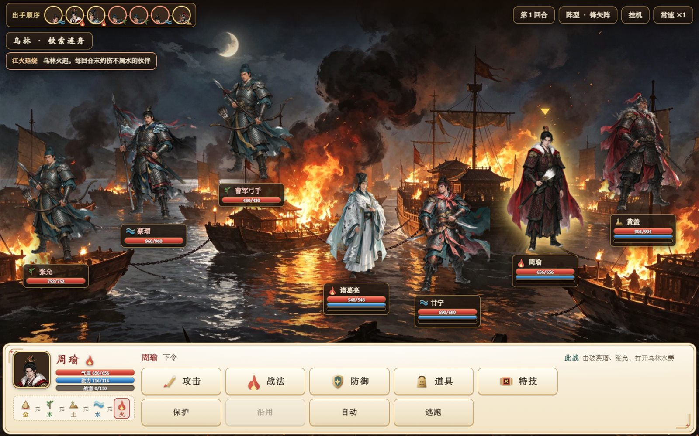
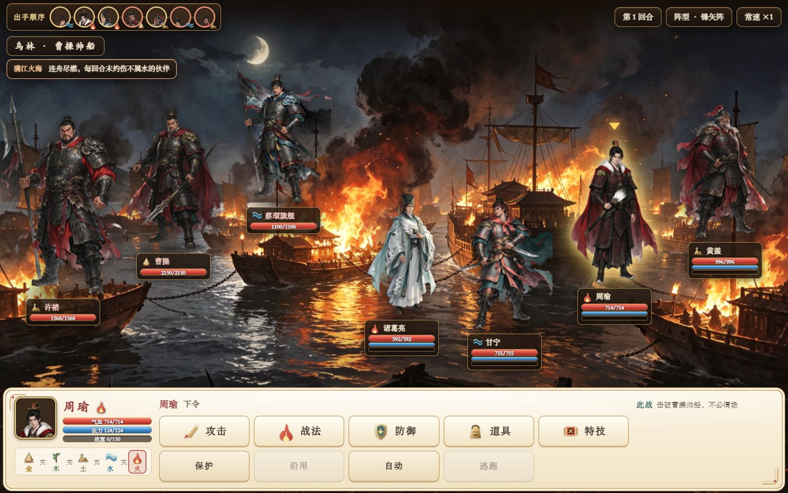
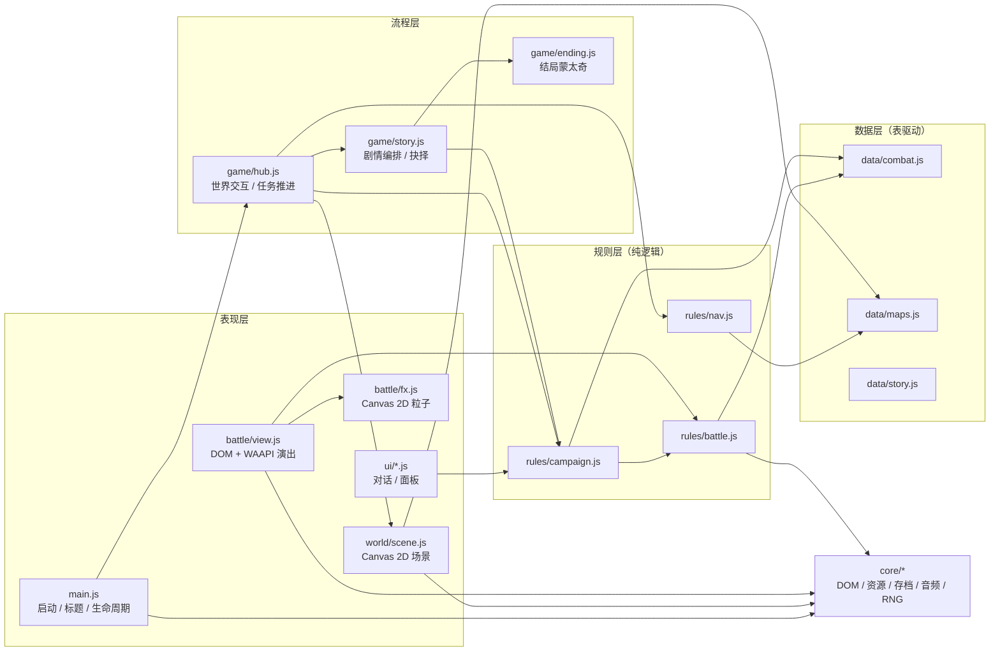
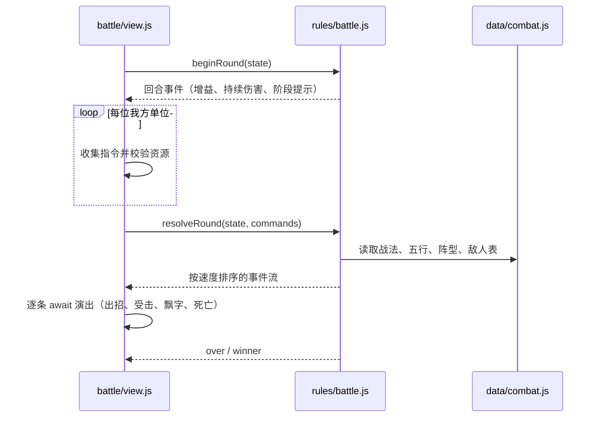

# 赤壁 · 东风

> 《三国演义》第四十三至五十回 · 国风探索 × 回合制队伍 RPG


**在线试玩：<https://damate758-ctrl.github.io/sanguo-chibi-dongfeng/>**

一款可以直接在浏览器里完整通关的叙事型回合制 RPG。玩家扮演东吴都督周瑜，在三江口点将、七星坛借风、乌林纵火，并在华容道作出最后的选择。全流程约 45 分钟，无后端、无安装、无账号，进度保存在本机浏览器。

<table>
  <tr>
    <td width="50%"></td>
    <td width="50%"></td>
  </tr>
  <tr>
    <td></td>
    <td></td>
  </tr>
</table>

---

## 目录

- [项目概览](#项目概览)
- [玩法系统](#玩法系统)
- [技术栈](#技术栈)
- [系统架构](#系统架构)
- [关键实现](#关键实现)
- [战斗数值模型](#战斗数值模型)
- [数据驱动与内容扩展](#数据驱动与内容扩展)
- [美术资产管线](#美术资产管线)
- [性能预算](#性能预算)
- [兼容性与可访问性](#兼容性与可访问性)
- [本地开发](#本地开发)
- [部署](#部署)
- [目录结构](#目录结构)
- [质量保证](#质量保证)
- [已知限制](#已知限制)
- [版权与素材声明](#版权与素材声明)

## 项目概览

《赤壁 · 东风》把《三国演义》第 43–50 回压缩成一条可交互的战役线：军议、巡江、苦肉计、借东风、火烧连舟、败走华容。它不是视觉小说，也不是单纯的战斗模拟，而是「可走场景 + 剧情编排 + 指令式回合战斗 + 角色养成」的组合。

| 维度 | 规格 |
| --- | --- |
| 类型 | 探索叙事 + 回合制队伍 RPG |
| 题材 | 《三国演义》第 43–50 回（赤壁之战） |
| 队伍 | 周瑜、黄盖、甘宁，诸葛亮以「军师」位入队 |
| 场景 | 三江口、七星坛、乌林水寨、华容道 |
| 流程 | 8 个战役阶段、3 场主线战斗、2 场可重复巡练、3 次剧情抉择、五层绘景结局 |
| 时长 | 约 45 分钟（首次通关，普通阅读节奏） |
| 平台 | 桌面与移动浏览器，横竖屏自适应 |
| 技术形态 | 原生 ES Module + Canvas 2D + Web Audio；无框架、无打包器、无运行时依赖、无后端 |
| 存档 | `localStorage`，版本化 schema（v3），不兼容存档自动失效 |
| 部署 | GitHub Pages 静态托管，单页应用，`404.html` 兜底 |

### 设计取舍

- **不做 3D。** 赤壁的表现力主要来自绘景、火光、烟尘与立绘演出；2D 图层 + Canvas 粒子能以更低的包体和更高的稳定性达到目标画面。
- **不引入引擎与框架。** 场景、战斗、UI 的职责边界清晰，直接使用浏览器原生能力可以避免框架运行时与构建链，也让规则层可以在 Node 中独立测试。
- **规则与表现彻底分离。** 伤害、命中、行动顺序、成长全部在纯函数中结算；表现层只消费事件流，不参与任何数值计算。
- **可复现。** 全局使用可设种子的 PRNG，规则层不调用 `Math.random()`；同一 seed + 同一指令必然得到同一结果，便于回归与平衡测试。

## 玩法系统

### 探索

- 四张 2400×1600 世界单位的手绘地形，摄像机跟随并带前瞻偏移，支持点击寻路、方向键行走与任务自动寻路。
- NPC、传送阵、地标、可交互光点均有独立标记与悬浮提示；主线 NPC 头顶显示任务符号。
- 场景内包含待机呼吸、行走颠步、脚步扬尘、水面雾气、火星、雨丝等环境层。
- 任务面板可一键追踪目标，角色会自动走过路网抵达交互点，不需要手动跑图。

### 战斗

- 指令式回合制：每回合先为每名伙伴下达指令，再按有效速度排序统一结算。
- 指令包含普通攻击、战法（MP）、特技（SP）、道具、防御、保护、阵型与自动应战。
- 五行相克、暴击、命中、减伤、护盾、易伤、速度增减、持续伤害等状态均在统一结算管线中处理。
- 两套阵型可每回合免费切换一次；Boss 拥有蓄力重击、阶段转换、援护与特殊胜利条件。
- 战场规则会改变打法：乌林火场每回合末灼伤不属水的角色，甘宁（水）可以无伤穿行。
- 支持全队挂机，玩家可随时接手；单角色也可选择「自动」让 AI 代打一回合。

### 成长与经济

- 五维成长：体魄、武勇、统御、身法、智略；每级 5 点自由分配，单项上限 40。
- 每级 1 点战法修炼点；战法每提升一重，威力 +6%、耗法 −2。
- 武器与甲胄双装备槽，装备提供属性与暴击加成；背囊支持战斗内外使用道具。
- 军需官商店、银两经济、任务奖励与可重复的「江防巡练」构成本作的经济循环。

### 叙事与分支

- 8 个战役阶段由 `game/story.js` 编排，场景切换、镜头、对话、战斗与结算解耦。
- 三次抉择会改变战斗态势或结局走向：火攻 / 稳守的战术选择、借风仪式、华容道的放行或拦截。
- 结局使用五层绘景蒙太奇（战场、火海、余烬、江雨、送别）与分层滤镜完成收束。

## 技术栈

| 层次 | 选型 | 职责 | 关键实现 |
| --- | --- | --- | --- |
| 语言 | ES2020 Modules | 全部业务代码 | 原生 `import` / `export`，浏览器直接加载，无转译 |
| UI | 原生 DOM + CSS Custom Properties | 标题、HUD、对话框、面板 | 设计令牌、`clamp()` 流式排版、媒体查询、`safe-area-inset` |
| 世界渲染 | Canvas 2D | 可走地图、角色、名牌、传送阵、氛围粒子 | 离屏底图合成、相机裁剪拷贝、DPR 上限 2、立绘切片摆动 |
| 战斗演出 | DOM + CSS Transform + Web Animations API | 单位站位、出手、受击、飘字 | 百分比槽位、按 y 排序的画家算法、Promise 化动画序列 |
| 特效 | Canvas 2D 粒子系统 | 刀光、冲击环、火焰、水波、天气 | 对象数组池、重力/阻力/寿命、`lighter` 叠加混合 |
| 音频 | Web Audio API | 背景音乐与音效 | 预合成双声道 `AudioBuffer`、五声音阶、程序化战鼓与江风 |
| 寻路 | A* + 路径拉直 | 点击寻路与自动寻路 | 20 单位栅格、二叉堆开放表、八邻域防切角、净空采样 |
| 持久化 | `localStorage` | 存档与设置 | JSON schema v3、损坏/过期存档降级、`pagehide` 自动保存 |
| 随机 | mulberry32 | 规则与掉落 | 显式 seed、独立随机流、规则层零 `Math.random()` |
| 测试 | Playwright（开发期） | 端到端验收 | 全流程自动通关、资源 404 监听、控制台异常监听、状态快照 |
| 部署 | GitHub Pages | 静态托管 | 根目录发布、`.nojekyll`、`404.html` 回退 |

**运行时依赖：0。** 仓库里没有 `package.json` 运行时依赖，也没有构建产物目录；`index.html` 直接加载 `js/main.js`。

## 系统架构

工程按「表现层 → 流程层 → 规则层 → 数据层」四层组织，依赖方向单一，规则层不引用任何 DOM API。



### 一次战斗回合的时序



**关键约束：** `battle/view.js` 只读取状态和事件，不修改 HP、伤害或命中率；`rules/battle.js` 不创建 DOM、不播放音频、不读取画面尺寸。这个边界让规则可以在无浏览器环境下回归，也让表现层可以独立替换。

## 关键实现

### 1. 世界地图：离屏合成 + 相机窗口拷贝

每张场景地形在进入时一次性绘制到 2400×1600 的离屏画布，并叠加径向暗角；主循环每帧只把相机视口对应的矩形拷贝到屏幕，避免逐帧重绘整张地图。

```js
ctx.imageSmoothingQuality = 'high';
ctx.drawImage(
  map.canvas,
  x0 * PX_PER_UNIT, y0 * PX_PER_UNIT,
  sw * PX_PER_UNIT, sh * PX_PER_UNIT,
  0, 0, view.w, view.h
);
```

- 设备像素比上限 2，避免 4K/高刷设备产生无意义的填充率开销。
- 缩放范围 0.6–1.3，按视口宽高自适应；摄像机在宽屏上加入 150/zoom 的前瞻偏移。
- 角色按 y 坐标做 0.9–1.06 的深度缩放，并绘制贴脚接触影与方向柔影。
- 小地图在进入场景时由同一张离屏图缩放生成，尺寸 300×200，不额外请求贴图。

### 2. 静态立绘的程序化运动

角色只有单张 800×1200 立绘，没有逐帧行走图。为了让待机与行走不僵硬，渲染器把立绘按高度切成「上身整块 + 下身 6 条横切片」，每条切片按相位差做水平位移，从视觉上模拟衣摆、重心与步伐。

```js
const slices = 6;
const shift = walk
  ? Math.sin(a.phase) * 4.5 * z * t
  : (Math.sin(a.phase * 0.5 + i * 0.62 + seed) * 1.35
     + Math.sin(a.phase * 0.2 + seed) * 0.9) * z * t;
```

配合呼吸缩放、身体倾角、脚步扬尘与落地音效，同一张立绘在站立、行走、被击退、倒下时都能保持连续的运动感，同时不需要为 12 名角色准备 8 方向行走图。

### 3. 点击寻路

`rules/nav.js` 由道路折线与占地矩形烘焙出可走栅格：

- 单元 20×20 世界单位，单场景 120×80 = 9600 个格子。
- 八邻域 A*，二叉堆维护开放表；禁止穿过两个对角障碍之间的缝隙。
- 路点做净空采样（每 8 单位检查一次），能直达的中间点直接删除，形成拉直后的折线路径。
- 与目标距离小于 96 单位即视为抵达；队伍成员按历史轨迹跟随，避免叠在一起。

### 4. 战斗演出

- 单位使用百分比槽位定位，宽屏与窄屏两套站位表，断点 700px。
- `z-index = 10 + round(y)`，保证站位靠下者覆盖靠上者，符合透视遮挡关系。
- 所有动作通过 Web Animations API 返回 Promise，演出脚本按事件流 `await` 串行播放，天然保证「先出招、再受击、再飘字」。
- 受击使用多段关键帧（压扁、位移、回弹），暴击叠加更高幅度与更长的飘字动画。
- 状态通过 CSS 滤镜表达：倒下灰化、蓄力红光、可选目标描边、当前行动者金色外发光。

### 5. 粒子与天气

`battle/fx.js` 是一个独立于规则的 2D 粒子层：

- 数据结构为扁平对象数组，字段包含位置、速度、重力、阻力、寿命、尺寸、颜色、形状与叠加模式。
- 形状覆盖 `dot / streak / shard / flame / crystal / puff`，几何特效覆盖 `slash / ring / star / sweep / bolt`。
- 主循环使用 `globalCompositeOperation = 'lighter'` 绘制发光粒子，普通烟尘回落为 `source-over`。
- 支持全屏闪白、元素染色、雾、火星、雨等环境天气，以及大范围火焰、江浪与烟尘的全屏演出。

### 6. 程序化音频

项目不包含任何音频文件。所有音乐与音效均由 Web Audio 实时合成：

- 五声音阶 `[0, 2, 4, 7, 9, 12, 14]`，五种情绪分别配置根音、BPM、小节数与鼓密度（标题 66、探索 78、战斗 112、Boss 132、结局 58）。
- 拨弦使用基频 + 2.004 / 3.01 泛音与指数包络；战鼓为下滑正弦 + LCG 噪声；江风为一阶低通滤波噪声。
- 每首曲子预合成到双声道 `AudioBuffer` 后循环播放，切曲使用 1.1 秒淡入与 0.85 秒交叉淡化。
- 音频上下文由首次 `pointerdown` / `keydown` 解锁；浏览器拒绝播放时静默降级，不影响玩法。

### 7. 确定性与可观测性

- 规则层统一使用 `createRNG(seed)`（mulberry32），不调用 `Math.random()`。
- URL 参数 `?seed=` 可复现整局；`?fast=1` 把演出节奏压缩到 0.12 倍，用于自动化回归。
- `window.chibi.snapshot()` 暴露只读状态快照（屏幕、场景、战役、战斗单位），供 Playwright 断言与问题定位。
- 资源加载失败会进入明确的错误界面；运行期异常通过 toast 提示，不静默吞错。

## 战斗数值模型

### 五行相克

```text
金 → 木 → 土 → 水 → 火 → 金
克制：伤害 ×1.5
被克：伤害 ×0.66
同属/无关系：×1.0
```

### 伤害结算

```text
有效属性 = 基础属性 × 阵型修正 × 形态修正 × 增益修正
基础伤害 = max(1, 攻击属性 × 战法倍率 − 防御属性 × 0.5)

最终倍率 =
    五行系数
  × 防御姿态（×0.5）
  × (1 − min(0.8, 减伤))
  × (1 + 易伤)
  × (1 − 元素抗性)
  × 阵型承伤修正

暴击：×1.5 ~ ×2.0
非暴击浮动：×0.9 ~ ×1.1
预览区间：最终伤害 ×0.9 ~ ×1.1（不消耗随机数）
命中率：clamp(基础命中 + 命中增益, 0.05, 1.0)
```

### 行动顺序

按有效速度降序；同速时我方优先，再按入场次序稳定排序。速度增益与减益在每回合结算前生效。

### 资源

| 资源 | 规则 |
| --- | --- |
| 法力 MP | 战法消耗；战法每修炼一重，耗法 −2 |
| 战意 SP | 上限 150；受伤获得 `max(3, round(伤害 / 最大气血 × 90))` |
| 特技 | 60 / 80 / 110 SP 三档 |
| 战法修炼 | 每重威力 +6%，最高三阶 |

### 阵型

| 阵型 | 增益 | 代价 |
| --- | --- | --- |
| 锋矢阵 | 武勇 +20%，身法 +5% | 所受伤害 +15% |
| 方圆阵 | 统御 +18%，所受伤害 −20% | 身法 −5% |

每回合可免费切换一次。阵型修正同时作用于输出与承伤，因此不是简单的数值开关。

### 成长

- 每级 5 点属性点、1 点战法点；单项属性分配上限 40。
- 属性收益：体魄 +9 气血；武勇 +2 攻击；统御 +2 防御；身法 +2 速度；智略 +2 智力、+2 法力。
- 角色等级受剧情等级约束（`storyLevel + 1`），避免提前刷级破坏节奏。

### 战场规则与 Boss

- 乌林火场：每回合末对不属水的单位造成 4.5% / 3.5% 最大气血伤害；水属性免疫。
- 曹操在回合数为 3 的倍数时进入蓄力：锁定当前气血最低的伙伴，下一回合以目标最大气血 60% 为基准重击；防御、减伤、保护与阵型均参与减免。
- 曹操气血降至 56% 时触发黄盖火船援护，造成 16% 最大气血伤害并附加 30% 破防。
- Boss 战以击破曹操为胜利条件，不要求清场，鼓励斩首与资源调度。

## 数据驱动与内容扩展

内容与引擎分离。新增角色、敌人、战法、战斗或场景，原则上不需要修改规则与渲染代码。

| 文件 | 内容 | 扩展方式 |
| --- | --- | --- |
| `js/data/combat.js` | 五行、战法、特技、角色、敌人、装备、道具、阵型、战斗配置 | 增加表项即可；规则层按 key 读取 |
| `js/data/maps.js` | 四张场景的道路、占地、NPC、传送阵、地标、刷怪点 | 增加 `SCENES` 条目并补充地形图 |
| `js/data/story.js` | 对白、旁白、教学、抉择文本 | 以数据结构描述，由 `game/story.js` 播放 |
| `js/data/art.js` | 资产路径、头像裁切参数、SVG 兜底规则 | 新增角色时登记 `PAINTED_UNITS` 与 `FACES` |
| `js/rules/*.js` | 战斗、战役、寻路 | 纯函数，可在 Node 中直接导入测试 |

新增一场战斗的最小改动：

1. 在 `ENEMIES` 中定义敌人属性、五行、战法与 AI。
2. 在 `BATTLES` 中声明敌人组合、战场规则、BGM 与胜利条件。
3. 在 `assets/units/` 放入立绘（可选 SVG 兜底），并在 `art.js` 登记。
4. 在 `story.js` 中接入触发点与战前/战后对白。

## 美术资产管线

美术采用「AI 生成关键帧 → 人工统一 → 透明化/压缩 → 引擎内演出」的管线。角色与场景均使用同一套绘本质感，标题页、世界层、战斗与剧情头像共享同一批源图。

| 资产 | 数量 | 规格 | 格式/体积 |
| --- | --- | --- | --- |
| 角色全身立绘 | 12 | 800×1200，透明背景，2:3 | WebP，约 190–280 KB/张 |
| 可探索地形 | 4 | 2400×1600，与地图坐标 1:1 | WebP，约 690–810 KB/张 |
| 战斗/标题绘景 | 6（含 1 张标题墨稿备用） | 2047–2048×1152 | JPEG，约 100–690 KB/张 |
| 道具图标 | 11 | 矢量 | SVG，< 1 KB/个 |
| 界面图标 | 20 | 矢量 | SVG，< 1 KB/个 |
| SVG 兜底 | 21 | 与立绘/地形/绘景同构 | SVG，数 KB |

**资产总量：** 74 个文件，约 8.4 MB；首屏预载约 5.4 MB，地形图按场景懒加载。

**命名约定：** `assets/units/<key>-paint.webp`、`assets/terrain/<scene>-paint.webp`、`assets/bg/<scene>-paint.jpg`。`data/art.js` 集中管理路径与头像裁切参数，渲染层不拼路径。

**加载策略：** 启动时并行预载标题、四张战斗绘景、全部界面/道具图标与 12 张立绘，进度条按完成数推进；任一必需资源失败会显示可读的错误页。地形图在进入场景时加载，避免首屏等待全部地图。

## 性能预算

| 项目 | 预算/实测 |
| --- | --- |
| 首屏预载 | 约 5.4 MB（标题绘景 + 4 张战斗绘景 + 12 张立绘 + 31 个 SVG） |
| 单场景地形 | 约 0.7–0.8 MB，进入时加载一次 |
| 仓库静态资源 | 74 个文件，约 8.4 MB |
| 设备像素比 | 上限 2 |
| 世界主循环 | 单 `requestAnimationFrame`，每帧一次视口裁剪拷贝 |
| 战斗 DOM | 单场最多 6–7 个单位，动画使用合成层属性 `transform` / `filter` |
| 粒子层 | 单画布、扁平数组、按寿命回收；无第三方粒子库 |
| 布局监听 | `ResizeObserver`，避免轮询与布局抖动 |
| 图片解码 | `img.decoding = 'async'`，预载阶段并行解码 |

## 兼容性与可访问性

- 目标环境为支持 ES Module、`ResizeObserver`、Web Animations API 与 Canvas 2D 的现代浏览器。
- 桌面验收环境为 Windows Edge / Chromium 1440×900；移动端使用响应式布局与安全区变量，但尚未在真实 iOS / Android 机型上做完整回归。
- 支持 `prefers-reduced-motion`，对动效敏感的用户会得到更收敛的过渡。
- 关键控件提供 `:focus-visible` 焦点环；弹层使用 `role="dialog"` 与 `aria-label`；战斗日志使用 `aria-live="polite"`。
- 触屏隐藏键盘提示，按钮最小高度 44px；刘海屏使用 `env(safe-area-inset-*)`。
- 音频需要一次用户手势解锁；静音与音量设置持久化，不影响任何规则判定。

## 本地开发

项目是纯静态站点，但 **不能以 `file://` 直接打开 `index.html`**：ES Module 与图片加载会被浏览器的同源策略拦截。

```powershell
# 方式一：仓库自带的零依赖静态服务器
node serve.mjs

# 方式二：Python
python -m http.server 5180

# 方式三：npx
npx serve .
```

然后访问 `http://127.0.0.1:5180/`。Windows 下也可以双击 `启动游戏.bat`（内部同样启动静态服务器）。

### 调试参数

| 参数 | 作用 |
| --- | --- |
| `?seed=20261122` | 固定随机种子，复现同一局 |
| `?fast=1` | 将演出节奏压缩到 0.12 倍，便于自动化与快速验收 |
| `window.chibi.snapshot()` | 读取当前屏幕、场景、战役与战斗状态快照 |

## 部署

仓库根目录即发布目录，GitHub Pages 直接从 `main` 分支根路径构建：

- `index.html` 为唯一入口，`404.html` 负责路径回退。
- `.nojekyll` 关闭 Jekyll 处理，保证 `assets/`、`js/` 原样发布。
- 所有引用均为相对路径，可部署在用户站点子路径下，也可迁移到任意静态托管（Cloudflare Pages、Netlify、对象存储）。
- 更新流程：替换 `assets/`、`css/`、`js/` 与入口文件，提交并推送 `main`，Pages 在一两分钟内完成构建，分享链接保持不变。

## 目录结构

```text
.
├─ index.html                 # 入口：舞台层 + 覆盖层，加载 js/main.js
├─ 404.html                   # GitHub Pages 回退页
├─ .nojekyll                  # 关闭 Jekyll
├─ docs/screenshots/          # README 展示图
├─ assets/
│  ├─ bg/                     # 战斗绘景、标题主视觉、SVG 兜底
│  ├─ terrain/                # 2400×1600 可探索地形
│  ├─ units/                  # 800×1200 透明立绘、SVG 兜底
│  ├─ items/                  # 道具图标（SVG）
│  └─ ui/                     # 界面图标（SVG）
├─ css/
│  ├─ base.css                # 设计令牌、排版、按钮、对话框
│  ├─ world.css               # 标题、HUD、场景、结局
│  ├─ battle.css              # 战斗布局、单位、指令面板
│  └─ panels.css              # 角色、背囊、任务、阵型、商店
└─ js/
   ├─ main.js                 # 启动、预载、标题、整局生命周期
   ├─ core/                   # dom / assets / store / audio / rng
   ├─ data/                   # art / maps / combat / story（纯数据）
   ├─ rules/                  # battle / campaign / nav（纯规则）
   ├─ world/                  # scene / hud（Canvas 场景与 HUD）
   ├─ battle/                 # view / fx（演出与粒子）
   ├─ game/                   # hub / story / ending（流程编排）
   └─ ui/                     # dialogue / panels / pager（界面组件）
```

工程规模：23 个 JS 模块、约 5,300 行、302 KB 源码；4 个 CSS 文件、约 76 KB；无第三方运行时依赖。

## 质量保证

发布前使用 Playwright（Chromium/Edge）跑了完整通关回归：

```text
标题 → 挥师入阵 → 三江口军议 → 巡江前哨战
→ 苦肉诈降 → 七星借风 → 诸葛亮入队
→ 乌林铁索连舟 → 曹操帅船 Boss 战
→ 华容道抉择 → 结局蒙太奇
```

最近一次远程验收（GitHub Pages 公网地址）：

- 最终状态 `campaign.stage = done`，三场主线战斗均正常结算。
- 全流程控制台错误 `0`，失败请求 `0`。
- 标题、三江口、七星坛、乌林、华容道与三场战斗均已截图核对。
- 远程冒烟脚本额外断言 `screen`、`world.scene`、`mapReady` 与资源 404。

## 已知限制

- 尚未在真实 iOS Safari、Android Chrome 与 Firefox 上做完整通关回归；当前结论基于 Windows Chromium 内核。
- 无配音；音乐与音效为程序化合成，风格统一但动态层次有限。
- 单张立绘 + 切片形变能覆盖待机与行走，但无法表达复杂动作；后续可替换为逐帧图或骨骼动画。
- 这是可玩展示版而非商业成品：数值曲线、镜头语言与支线容量仍有扩展空间。
- 只改编第 43–50 回；赤壁之后的荆州争夺仅作为结局后日谈出现。

## 版权与素材声明

- 《三国演义》原文为公版作品。
- 角色立绘与场景绘景由本项目使用 AI 图像生成后统一处理，未直接复制参考站、影视、游戏或第三方绘画素材。
- 界面、程序化特效、音乐合成与全部代码为原创实现。
